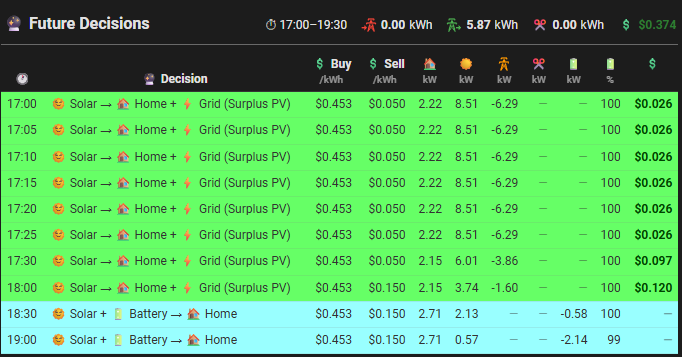

# Energy Manager - Forecast Card

A compact Home Assistant card for the **[Energy Manager][energy-manager-url]** addon. Shows the next few plan slots (10 by default) from `sensor.energy_manager_plan` in a small, icon-header table — including **curtailed PV** and the **expected cost / profit** for each slot — with the totals for the window in the title row.

It is a drop-in replacement for a markdown "🔮 Future Decisions" table, and uses the same decision labels, colours, pricing and cost logic as the full **[EM Events Card](../)**.

Current version: ![version][em-forecast-version-badge]

---



## Features

- **Next N slots** from `sensor.energy_manager_plan` (`energy_plan.timeline`); slots that have already started are skipped, and the table refreshes when the plan changes and once a minute
- **Decision labels and row colours** identical to the EM Events Card Future Decisions tab, including `(Surplus PV)` and `+ 🚗 EV (mode)` suffixes
- **Provider-aware prices** via `input_select.electricity_provider` — Globird and Flow Power tariffs from their helpers, other providers from the plan; Globird super-export daily cap applied (⚠ shown on the sell price)
- **✂️ Curtailed kW** per slot: `max(0, PV − (Load + Battery charge + Export))`
- **💲 Cost / Profit** per slot: `(Import × Buy − Export × Sell) × interval`; cost in red with a minus sign, profit in green
- **Totals in the title row** for the window: grid import, grid export, curtailed and EV kWh, and net cost / profit
- **🚗 EV column** shown automatically only when a slot in the window has EV charging
- Icon-only column headers to save width — hover any header or total for its meaning

## Columns

| Header | Column | Unit |
|---|---|---|
| 🕐 | Slot start time | |
| 🔮 Decision | Planned decision | |
| 💲 Buy | Buy price | /kWh |
| 💲 Sell | Sell price | /kWh |
| 🏠 | Load | kW |
| ☀️ | Solar | kW |
| `mdi:transmission-tower` | Grid (import +, export −) | kW |
| ✂️ | Curtailed PV | kW |
| 🚗 | EV charging (auto) | kW |
| 🔋 | Battery (charge +, discharge −) | kW |
| 🔋 | Battery SoC at slot start | % |
| 💲 | Expected cost / profit | $ |

## Configuration

```yaml
type: custom:em-forecast-card
grid_options:
  columns: full
```

All options are optional — defaults shown:

```yaml
type: custom:em-forecast-card
grid_options:
  columns: full
entity: sensor.energy_manager_plan
provider_entity: input_select.electricity_provider
title: 🔮 Future Decisions
rows: 10
currency_symbol: $
row_colours: true          # false = theme colours, no EM event tints
show_curtailed: true
show_ev: auto              # true | false | auto
show_totals: true
buy_decimals: 3
sell_decimals: 3
grid_threshold_w: 50       # same defaults as the EM Events Card settings
battery_threshold_w: 100
curtail_threshold_w: 100
ev_threshold_w: 100
```

### Replacing a markdown Future Decisions card

Swap the `type: markdown` card (and its `entity_id` / `content` template) for the card above. Keep any `view_layout` / `grid_options` block so the card stays in the same position. `entity_id` is not needed — the card refreshes itself.

## Sensors used

| Entity | Required | Used for |
|---|---|---|
| `sensor.energy_manager_plan` | Yes | Timeline (`energy_plan` attribute, object or JSON string) |
| `input_select.electricity_provider` | No | Provider-specific pricing (defaults to plan prices) |
| `input_datetime.globird_*`, `input_number.globird_*` | Globird only | Tariff windows and prices, super-export cap |
| `sensor.daily_exported_energy` | Globird only | Super-export cap already used today |
| `input_datetime.flowpower_*`, `input_number.flowpower_*` | Flow Power only | Buy price and peak / off-peak feed-in |

See [em-sensors-used.md](../em-sensors-used.md) for the full Energy Manager sensor list.

## Known limitations

- The Globird super-export cap compares each slot with today's export so far; it does not add up export planned in earlier forecast slots (same as the EM Events Card).
- `(Surplus PV)` is also appended to forced-export labels when solar alone covers home + battery (same as the EM Events Card).

<!-- Badges -->

[em-forecast-version-badge]: https://img.shields.io/badge/dynamic/json?url=https%3A%2F%2Fraw.githubusercontent.com%2FRoving-Ronin%2FEMS-Events-Card%2Fmain%2Fversions.json&query=%24.em_forecast&label=&style=flat-square&color=grey

<!-- References -->

[energy-manager-url]: https://github.com/ha-energymanager/ha-energymanager
