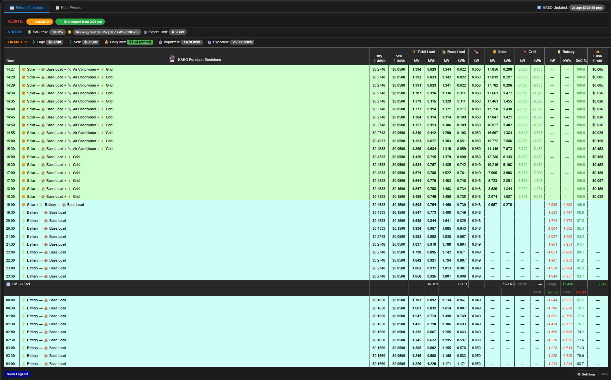
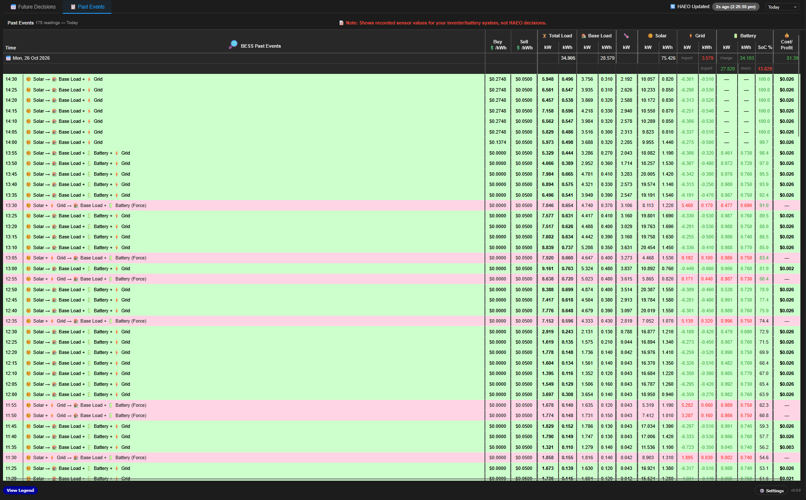

# Energy Management Systems — Events Card

[![hacs][hacs-badge]][hacs-url]
[![release][release-badge]][release-url]
[![downloads][downloads-badge]][release-url]
[![maintained][maintained-badge]][commits-url]
[![activity][activity-badge]][commits-url]
[![license][license-badge]][license-url]

___
> **Install once via the Marketplace (or HACS) — all cards are registered as dashboard resources automatically.**
 
A collection of custom Home Assistant Lovelace cards for the following Energy Management Systems (EMS):

- [Energy Manager][energy-manager-url]
- [Home Assistant Energy Optimiser (HAEO)][haeo-url]
- [EMHASS — Energy Management for Home Assistant][emhass-url]

All three cards share a consistent two-tab layout (Future Decisions + Past Events), column structure, colour conventions and auto-refresh behaviour. Depending upon the sensors and specific data available from each of the EMS, the card differs slightly between each of the different versions. The example screenshots below are usually based off the HAEO version. 

### Future Decisions



### Past Events



---

## Cards

For more detailed views and information for each specific card, please refer to their read.me files (below):

| Card | Type | For | Version |
|------|------|-----|---------|
| <a href="https://github.com/Roving-Ronin/EMS-Events-Card/blob/main/EnergyManager/" target="_blank">EM Events Card</a> | `custom:em-events-card` | [Energy Manager][energy-manager-referral] | ![EM version][em-version-badge] |
| <a href="https://github.com/Roving-Ronin/EMS-Events-Card/blob/main/EnergyManager/Forecast-Card/" target="_blank">EM Forecast Card</a> | `custom:em-forecast-card` | [Energy Manager][energy-manager-referral] | ![EM Forecast version][em-forecast-version-badge] |
| <a href="https://github.com/Roving-Ronin/EMS-Events-Card/blob/main/HAEO/" target="_blank">HAEO Events Card</a> | `custom:haeo-events-card` | [Home Assistant Energy Optimiser][haeo-url] | ![HAEO version][haeo-version-badge] |
| <a href="https://github.com/Roving-Ronin/EMS-Events-Card/blob/main/EMHASS/" target="_blank">EMHASS Events Card</a> | `custom:emhass-events-card` | [Energy Management for Home Assistant][emhass-url] | ![EMHASS version][emhass-version-badge] |

---

## Installation Methods:

### Marketplace (Home Assistant 2026.11 and newer)

[![Open this repository in the Marketplace][marketplace-button]][marketplace-url]

Or install manually from the Marketplace:

1. Go to **Settings → Marketplace**
2. Search for **Energy Management Systems - Events Cards**
3. Click **Download**
4. Hard-refresh your browser (`Ctrl+Shift+R` / `Cmd+Shift+R`)

### HACS (Home Assistant 2026.10 and older)

[![Open this repository in HACS][hacs-button]][hacs-url]

Or install manually from HACS:

1. Open **HACS**
2. Search for **Energy Management Systems - Events Cards**
3. Click **Download**
4. Hard-refresh your browser (`Ctrl+Shift+R` / `Cmd+Shift+R`)

All card types will be available immediately — add whichever you need to your dashboard.

---

## Adding Cards to Your Dashboard

Once installed, add whichever card(s) apply to your setup:

### Energy Manager
```yaml
type: custom:em-events-card
grid_options:
  columns: full
```

### Energy Manager — compact forecast
A small, icon-header table of the next 10 plan slots with curtailment and expected cost / profit — a drop-in replacement for a markdown "Future Decisions" table.
```yaml
type: custom:em-forecast-card
```

### HAEO
```yaml
type: custom:haeo-events-card
grid_options:
  columns: full
```

### EMHASS
```yaml
type: custom:emhass-events-card
grid_options:
  columns: full
```

See each card's README for full configuration options and required sensors.

---

## Versioning

The version is displayed in the card's legend footer. Releases use a single bundle version (vX.Y.Z); with each individual card’s own being independently versioned and shown in its legend footer and in the table above. Versioning is based upon the format of  `v[major].[minor].[patch]`. 

---

## Credits: 

Inspired by an original EMHASS events card by Matt ( Discord ID: matt099351 )

---

## License

GNU General Public License v3.0 — see [LICENSE](./LICENSE).

You are free to use, modify and share these cards. If you distribute them or any modified version, including as part of another product, the whole work must also be released under GPL-3.0 with its source code. For use under other terms (e.g. in a closed-source or commercial product), contact the author for a commercial licence.

<!-- Card versions (from versions.json) -->

[em-version-badge]: https://img.shields.io/badge/dynamic/json?url=https%3A%2F%2Fraw.githubusercontent.com%2FRoving-Ronin%2FEMS-Events-Card%2Fmain%2Fversions.json&query=%24.em&label=&style=flat-square&color=grey
[em-forecast-version-badge]: https://img.shields.io/badge/dynamic/json?url=https%3A%2F%2Fraw.githubusercontent.com%2FRoving-Ronin%2FEMS-Events-Card%2Fmain%2Fversions.json&query=%24.em_forecast&label=&style=flat-square&color=grey
[haeo-version-badge]: https://img.shields.io/badge/dynamic/json?url=https%3A%2F%2Fraw.githubusercontent.com%2FRoving-Ronin%2FEMS-Events-Card%2Fmain%2Fversions.json&query=%24.haeo&label=&style=flat-square&color=grey
[emhass-version-badge]: https://img.shields.io/badge/dynamic/json?url=https%3A%2F%2Fraw.githubusercontent.com%2FRoving-Ronin%2FEMS-Events-Card%2Fmain%2Fversions.json&query=%24.emhass&label=&style=flat-square&color=grey

<!-- Badges -->

[hacs-url]: https://my.home-assistant.io/redirect/hacs_repository/?owner=Roving-Ronin&repository=EMS-Events-Card&category=plugin
[hacs-badge]: https://img.shields.io/badge/hacs-default-orange.svg?style=flat-square
[release-badge]: https://img.shields.io/github/v/release/Roving-Ronin/EMS-Events-Card?style=flat-square&color=green
[downloads-badge]: https://img.shields.io/github/downloads/Roving-Ronin/EMS-Events-Card/total?style=flat-square
[maintained-badge]: https://img.shields.io/badge/maintained-yes-brightgreen?style=flat-square
[activity-badge]: https://img.shields.io/github/commit-activity/y/Roving-Ronin/EMS-Events-Card?style=flat-square
[license-badge]: https://img.shields.io/github/license/Roving-Ronin/EMS-Events-Card?style=flat-square

<!-- Install buttons -->

[marketplace-button]: https://my.home-assistant.io/badges/marketplace_repository.svg
[marketplace-url]: https://my.home-assistant.io/redirect/marketplace_repository/?owner=Roving-Ronin&repository=EMS-Events-Card
[hacs-button]: https://my.home-assistant.io/badges/hacs_repository.svg

<!-- References -->

[release-url]: https://github.com/Roving-Ronin/EMS-Events-Card/releases
[commits-url]: https://github.com/Roving-Ronin/EMS-Events-Card/commits/main
[license-url]: https://github.com/Roving-Ronin/EMS-Events-Card/blob/main/LICENSE
[energy-manager-url]: https://energymanager.com.au/
[energy-manager-referral]: https://energymanager.com.au/usersc/join.php?ref=FE8J34EN
[haeo-url]: https://github.com/hass-energy/haeo
[emhass-url]: https://github.com/davidusb-geek/emhass
